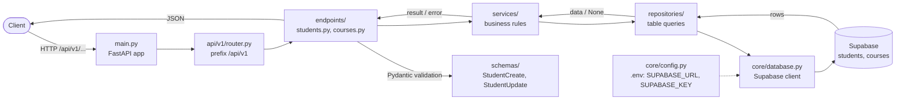
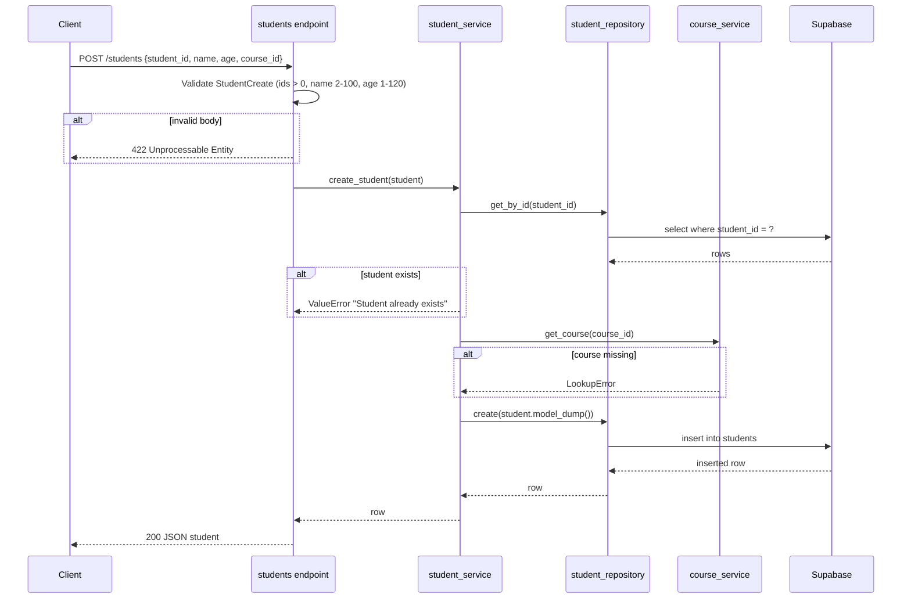

# Request Flow

## Layered architecture

## Create student (POST /api/v1/students/)

## Notes

- `get_students` (GET `/students/`) skips the checks: endpoint → service → repository `get_all()` → Supabase, ordered by `student_id`.
- `ValueError` and `LookupError` raised in services are not caught by the endpoints yet, so they currently surface as 500 responses. Mapping them to 409 / 404 (via `HTTPException` or exception handlers) is the usual next step.
- `update_student`, `get_student` and `delete_student` exist in the service but are not routed in `students.py` yet.
